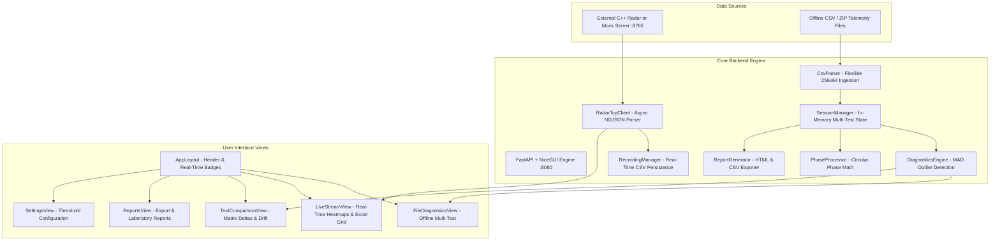

# PSP Radar Diagnostics (Developer Documentation)

This repository contains the source code for the **PSP (Phase Synchronized Processing) Radar Diagnostics** platform. This document is intended for **Developers, Contributors, and Build Engineers**. 

If you are an end-user looking for instructions on how to use the compiled `.exe` application, please refer to the **`USER_GUIDE.md`**.

---

## 🛠️ Technology Stack

This application is a full-stack Python application utilizing modern asynchronous patterns and a reactive frontend UI.

* **Backend Framework:** FastAPI (ASGI server)
* **Frontend Framework:** NiceGUI (Vue3/Quasar under the hood, manipulated entirely via Python)
* **Data Processing:** Pandas, NumPy (Vectorized matrix operations)
* **Visualizations:** Plotly (Interactive WebGL 2D/3D charts)
* **Networking:** Asyncio (Non-blocking TCP socket streams, NDJSON parsing)
* **Packaging:** PyInstaller (Bundles Python, frontend assets, and dependencies into a single `.exe`)

---

## 🚀 Setup & Local Development

### 1. Environment Setup
You must use **Python 3.10+**. Set up your virtual environment and install dependencies:

```bash
cd /workspace/visual_diagnostic/radar_diagnostics
python3 -m venv .venv
source .venv/bin/activate
pip install -r requirements.txt
```

### 2. Launching the Web App (Dev Mode)
To run the NiceGUI web server locally with auto-reload enabled:

```bash
python run_app.py --port 8080 --host 0.0.0.0 --reload
```
Navigate to `http://localhost:8080` in your browser.

### 3. Launching the Mock TCP Server
To develop the Live Stream features without physical radar hardware, use the included Mock Server. 

Open a *second terminal*:
```bash
source .venv/bin/activate
python run_mock_server.py --port 8765 --rate 1.0 --mode AMP
```
*Note: The mock server generates synthetic 256x64 matrices and simulates dead elements, noise spikes, and phase jumps.*

### 4. Running Automated Tests
The project includes a comprehensive suite of unit and integration tests (26+ tests).
```bash
pytest
```

---

## 📦 Building Executables

We use PyInstaller to compile the source code into standalone executables for Linux and Windows. 

To automate the build process, a helper script is located in the root workspace.

### **Automated Build Script**
In your terminal, simply run:
```bash
cd /workspace
./update_builds.sh
```

**What this script does:**
1. **Linux Build:** Runs PyInstaller using `PSP_Radar_Diagnostics.spec` to create a Linux binary inside `dist/`.
2. **Windows Kit Update:** Copies the latest `app/` Python source and assets into the `Windows_Build_Kit/` directory.
3. **Packaging:** Zips both outputs into `PSP_Radar_Release.tar.gz` and `Windows_Build_Kit.tar.gz` located in the `/workspace/builds/` folder.

> [!IMPORTANT]
> **Windows Cross-Compilation Constraint:**
> Because this environment is an air-gapped Ubuntu container, native Windows `.exe` compilation via PyInstaller is not possible here. 
> To generate the Windows `.exe`, a developer must download the `Windows_Build_Kit.tar.gz`, extract it to their local Windows `C:\` drive, and run the `Build_Windows_Executables.bat` script provided inside.

---

## 🏛️ System Architecture



### Protocol Specifications (Live Stream)
The TCP client parses **NDJSON** (Newline-Delimited JSON) over raw TCP.
* **Framing:** UTF-8 JSON string terminated by `\n`.
* **Dimensions:** Data matrices must always be exactly `(256 elements, 64 frequencies)`.

Example Frame:
```json
{
  "message_type": "radar_frame",
  "sequence": 1042,
  "data_type": "AMP",
  "elements": 256,
  "frequencies": 64,
  "data": [[-12.4, -13.1], ["..."]]
}
```

---

## 📁 Project Structure

* `run_app.py` - Main FastAPI/NiceGUI entry point.
* `run_mock_server.py` - Development mock data TCP server.
* `app/config.py` - Global thresholds and settings definitions.
* `app/core/` - Data parsers, phase processors, and diagnostic math (pandas/numpy heavy).
* `app/streaming/` - Asyncio TCP client and disk recording managers.
* `app/ui/` - NiceGUI visual frontend components (Layouts, Heatmaps, Settings).
* `app/game/` - Compiled Angular application (Static HTML/JS) embedded into the Python app via iframe.
