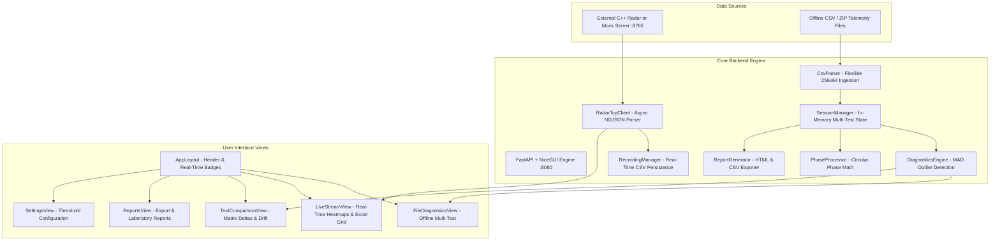

# PSP Radar Diagnostics & Live Monitoring Platform

A laboratory-grade Python diagnostics platform for Radar Phase Synchronized Processing (PSP) matrices.

This platform allows radar engineers to analyze multi-test offline logs, monitor live high-rate TCP data streams, record telemetry to disk, diagnose element/channel stability, and generate comprehensive engineering reports.

---

## 🚀 How to Run the App

The Python environment is located at [`.venv`](.venv).

### 1. Launch the Web Application (NiceGUI Dashboard)

In your terminal:

```bash
cd /workspace/visual_diagnostic/radar_diagnostics
source .venv/bin/activate
python run_app.py --port 8080 --host 0.0.0.0
```

- **URL**: Open your browser to **`http://localhost:8080`** (or through Cloud Workstation port proxy on port `8080`).
- **Options**:
  - `--host`: Bind host (default: `0.0.0.0`)
  - `--port`: Port number (default: `8080`)
  - `--reload`: Enable auto-reload on code change

---

### 2. Launch the Mock Radar TCP Server (For Live Streaming)

> [!IMPORTANT]
> The Web Application connects to a live TCP radar feed on port `8765`. If you click **Connect** in the web dashboard without starting this server first, the connection will fail with:
> `ERROR: [Errno 111] Connection refused`
> Always run this server in a separate terminal before connecting to live stream!

In a second terminal:

```bash
cd /workspace/visual_diagnostic/radar_diagnostics
source .venv/bin/activate
python run_mock_server.py --port 8765 --rate 1.0 --mode AMP
```

- **Options**:
  - `--host`: Bind address (default: `0.0.0.0`)
  - `--port`: Port number (default: `8765`)
  - `--rate`: Frame transmission frequency in Hz (default: `1.0`)
  - `--mode`: Data mode: `AMP`, `NOISE`, `PHASE`, or `MIXED` (default: `AMP`)
  - `--clean`: Run clean stream without injected hardware faults

---

### 3. Generate Synthetic Test Datasets (Optional)

To regenerate sample CSV logs, multi-test batches, and sample ZIP archives for offline file diagnostics:

```bash
cd /workspace/visual_diagnostic/radar_diagnostics
source .venv/bin/activate
python scripts/generate_sample_data.py
```

Generated files are placed in [`sample_data/`](sample_data/):
- `sample_data/AMP/` (Tests 1–10)
- `sample_data/NOISE/` (Tests 1–10)
- `sample_data/PHASE/` (Tests 1–10)
- `sample_data/combined/` (Aggregated multi-test CSVs)
- `sample_data/sample_dataset.zip` (Ready for drag-and-drop testing)

---

### 4. Run Automated Tests

Execute the automated test suite (26 unit and integration tests):

```bash
cd /workspace/visual_diagnostic/radar_diagnostics
source .venv/bin/activate
pytest
```

---

## 🏛️ System Architecture



---

## 🧩 Detailed Explanation of All Components

The platform is organized into three primary layers: **Launchers & Entry Points**, **Core Backend Engines**, and **Frontend User Interface Views**.

### 1. Launchers & Entry Points

- **[`run_app.py`](run_app.py)**:
  - Command-line launcher for the NiceGUI web application.
  - Parses `--host`, `--port`, and `--reload` arguments.
  - Registers all application routes and launches the ASGI server (`ui.run`).
- **[`run_mock_server.py`](run_mock_server.py)**:
  - Standalone simulation server emulating real radar hardware.
  - Periodically synthesizes 256 Elements × 64 Frequencies matrices at specified frame rates (e.g. 1 Hz) in `AMP`, `NOISE`, `PHASE`, or `MIXED` modes.
  - Supports fault simulation (dead elements, stuck channels, phase jumps) to validate diagnostic detection.
- **[`scripts/generate_sample_data.py`](scripts/generate_sample_data.py)**:
  - Utility script producing deterministic offline test datasets for amplitude, noise, and phase modes, along with known ground truth anomalies.

---

### 2. Core Backend Engine (`app/core/`, `app/streaming/`, `app/reporting/`)

- **[`app/config.py`](app/config.py) (`AppConfig`)**:
  - Central configuration singleton.
  - Defines network defaults (`gui_host`, `gui_port=8080`, `tcp_server_port=8765`), directory paths (`sample_data`, `recordings`, `reports`), matrix dimensions (256×64), standard MAD anomaly thresholds, and laboratory visual palette definitions.
- **[`app/main.py`](app/main.py)**:
  - Initializes the singletons: `SessionManager`, `RadarTcpClient`, and `RecordingManager`.
  - Sets up FastAPI route handlers, mounts static directories (`/reports` and `/static`), and registers graceful shutdown hooks to safely close TCP sockets and active disk recording handles.
- **[`app/core/session_manager.py`](app/core/session_manager.py) (`SessionManager`)**:
  - Master in-memory diagnostic state holder.
  - Manages loaded multi-test matrices (`tests_data`), active data mode, channel labels (`A`–`BL`), element list (`1`–`256`), and anomaly detection results.
- **[`app/core/csv_parser.py`](app/core/csv_parser.py) (`CsvParser`)**:
  - High-performance CSV parser that handles both single test files and combined multi-test tables.
  - Unpacks ZIP archive bundles on the fly.
  - Automatically identifies column structures, validates matrix bounds, and detects data types (`AMP`, `NOISE`, `PHASE`).
- **[`app/core/phase_processing.py`](app/core/phase_processing.py) (`PhaseProcessor`)**:
  - Handles circular trigonometric arithmetic required for radar phase diagnostics:
    - Normalizes phase angles into the `[-180°, 180°)` degree interval.
    - Calculates circular mean and circular variance without artificial boundary discontinuities.
    - Computes shortest signed angular differences between successive radar tests:
      $$\Delta\theta = ((\theta_1 - \theta_2 + 180^\circ) \pmod{360^\circ}) - 180^\circ$$
- **[`app/core/diagnostics.py`](app/core/diagnostics.py) (`DiagnosticsEngine`)**:
  - Core anomaly detection engine.
  - Uses **Median Absolute Deviation (MAD)** for robust statistical outlier identification:
    $$\text{MAD} = \text{median}(|X_i - \text{median}(X)|)$$
  - Evaluates elements and channels against global laboratory tolerance limits and flags dead elements, noisy channels, and drift anomalies.
- **[`app/streaming/tcp_client.py`](app/streaming/tcp_client.py) (`RadarTcpClient`)**:
  - Non-blocking asynchronous TCP client running via `asyncio`.
  - Handles NDJSON (Newline-Delimited JSON) framing, stream defragmentation, and socket reconnection.
  - Maintains a sliding in-memory frame buffer and computes live telemetry statistics (ingestion rate, frame drops, sequence gap detection).
- **[`app/streaming/recording_manager.py`](app/streaming/recording_manager.py) (`RecordingManager`)**:
  - Background streaming disk persistence engine.
  - Persists incoming live radar telemetry frames directly into standard CSV format on disk in real time.
  - Saved recording sessions can be immediately reopened inside the File Diagnostics view.
- **[`app/reporting/report_generator.py`](app/reporting/report_generator.py) (`ReportGenerator`)**:
  - Generates self-contained HTML laboratory test reports and CSV anomaly exports.
  - Formats summary statistics, test comparison graphs, and flagged outliers.

---

### 3. Frontend UI Views (`app/ui/`)

- **[`AppLayout`](app/ui/layout.py)**:
  - Master layout orchestrator styled in the laboratory blue theme (`#1976D2`).
  - Persistent header displaying live status indicators:
    - **Source Badge**: Indicates whether active data is from `CSV` files or `LIVE TCP`.
    - **TCP Badge**: Real-time status (`DISCONNECTED`, `CONNECTING`, `CONNECTED`, `ERROR`).
    - **Recording Badge**: Displays recording state (`OFF` / `REC ON`).
    - **Session Label**: Current laboratory session name.
  - Manages primary navigation tabs: *File Diagnostics*, *Live Stream & Recording*, *Test Comparison*, *Reports & Exports*, and *Settings*.
- **[`FileDiagnosticsView`](app/ui/file_diagnostics.py)**:
  - **Upload & Dataset Loading**: Supports drag-and-drop CSV / ZIP uploads or one-click loading of sample datasets.
  - **Overlaid Test Curves**: Displays dB vs. Element graphs across all tests for any selected frequency channel (`A` through `BL`).
  - **Element Frequency Response**: Graphs dB vs. Frequency for any selected radar element.
  - **2D Matrix Heatmap**: Full 256 Elements × 64 Frequencies interactive heatmap.
  - **Anomalies Table**: Filterable table showing flagged outliers with severity ratings.
- **[`LiveStreamView`](app/ui/live_stream.py)**:
  - **Connection Controller**: Host IP, port inputs, and Connect/Disconnect action buttons.
  - **Streaming Metrics**: Live frame rate (FPS), ingested frames counter, and sequence continuity tracker.
  - **Recording Switch**: Start/Stop real-time disk recording.
  - **Live Matrix Stream (Excel View)**: 16-channel scrolling window presenting matrix cells in real time.
  - **Temporal Charts**: Dynamic rolling line plots and live updating heatmaps.
- **[`TestComparisonView`](app/ui/comparison.py)**:
  - Delta and drift analysis comparing multiple radar tests against a designated reference test.
  - Displays difference curves and distribution shifts across elements and channels.
- **[`ReportsView`](app/ui/reports_view.py)**:
  - Interface for generating and downloading consolidated HTML laboratory test reports and raw CSV data extracts.
- **[`SettingsView`](app/ui/settings_view.py)**:
  - Configuration panel allowing radar engineers to tune MAD multiplier factors, absolute tolerance limits for amplitude/noise, and phase delta limits.

---

## 📡 Live Streaming Protocol Specifications

The TCP client and mock server communicate via **NDJSON (Newline-Delimited JSON)** over raw TCP:

- **Port**: `8765` (configurable)
- **Framing**: UTF-8 encoded JSON string terminated by `\n` (`0x0A`)
- **Payload Schema**:
  ```json
  {
    "protocol_version": 1,
    "message_type": "radar_frame",
    "sequence": 1042,
    "timestamp": "2026-11-22T09:15:00Z",
    "session_id": "session_001",
    "test_id": "test_001",
    "data_type": "AMP",
    "unit": "dB",
    "elements": 256,
    "frequencies": 64,
    "frequency_labels": ["A", "B", "C", "...", "BL"],
    "element_ids": [1, 2, 3, "...", 256],
    "data": [
      [-12.4, -13.1, -12.8, "..."],
      ["..."]
    ]
  }
  ```
- **Matrix Dimension**: Matrix shape is always `(256, 64)` where axis 0 represents elements and axis 1 represents frequency channels.
